# Video Gallery

[Docs index](README.md) · [Branding](BRANDING.md) · [Data contracts](DATA-CONTRACTS.md)

## v0.5.0 Compositions

These are unmodified frames decoded from complete MP4s exported by the generator,
using the [public, reproducible episodes](../examples/v0.5.0/README.md). Every
example includes its recording, measured word timings, captions, artwork and
storyboard. The illustrative **Example Lab** identity uses bundled licensed fonts.
The screenshots show the actual compositions and captions, not marketing mockups.

### Animated Data / 16:9

| Opening question | Progressive comparison |
| :---: | :---: |
| <a href="images/v050-data-opening.png">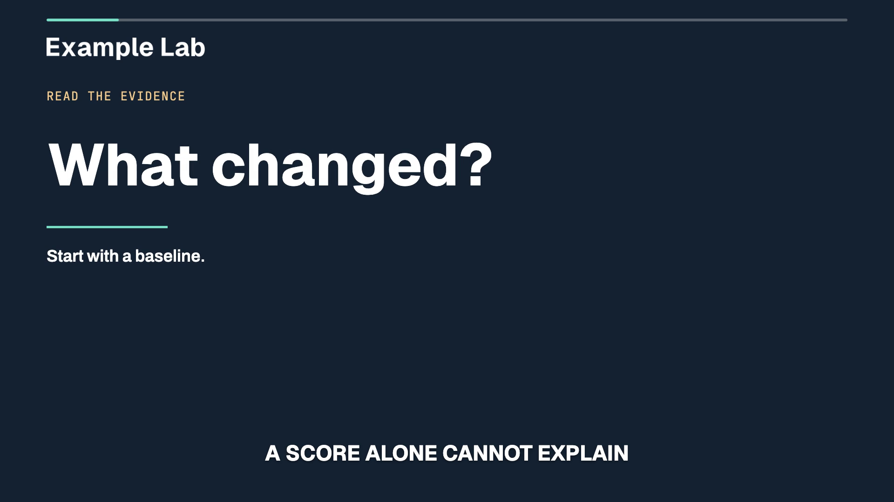</a> | <a href="images/v050-data-chart.png">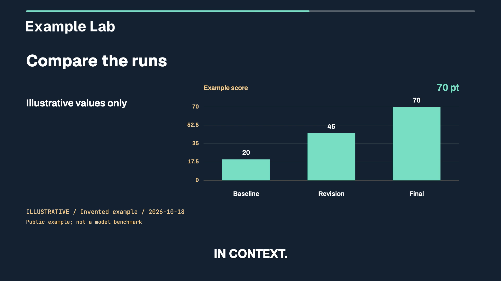</a> |

The bars reveal on three separate speech cues, followed by a source-checking
conclusion. Values are invented illustrations, not measured model performance.
[Complete storyboard](../examples/v0.5.0/data-story/storyboard.json).

### Camera Sequence / 9:16 and Source Inspection / 4:5

| Portrait camera sequence | Feed-format focus move |
| :---: | :---: |
| <a href="images/v050-camera-portrait.png">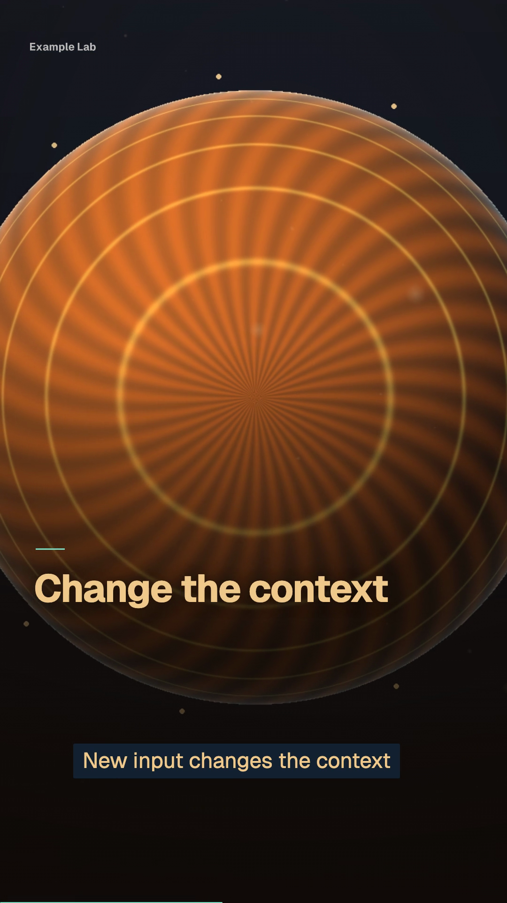</a> | <a href="images/v050-screen-focus.png">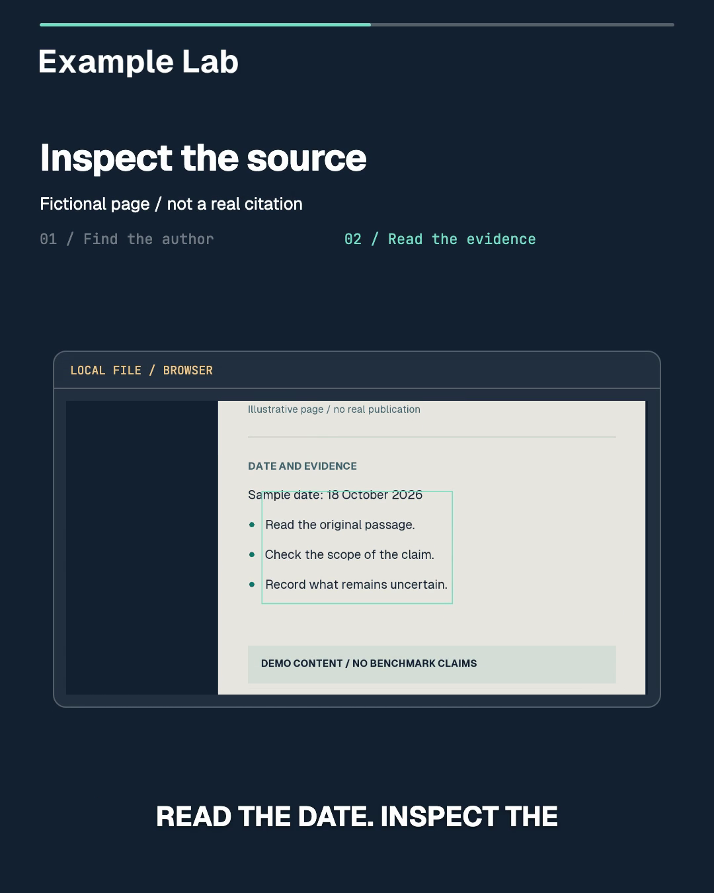</a> |

The portrait uses the photographic scene family with original procedural stills:
three camera paths, a focus cut and a foreground occlusion. The 4:5 episode starts
with the full fictional page, then moves to two explicit regions before its close.
[Camera storyboard](../examples/v0.5.0/camera-story/storyboard.json) ·
[Screen storyboard](../examples/v0.5.0/screen-story/storyboard.json).

### Matched Headlines and Text States / 1:1

| Matched title pair | Caption-driven text |
| :---: | :---: |
| <a href="images/v050-type-match.png">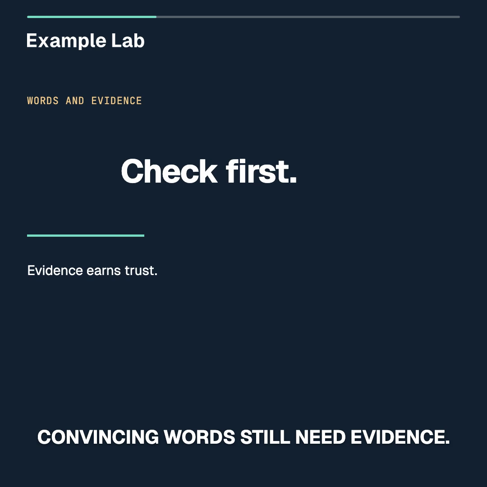</a> | <a href="images/v050-type-state.png">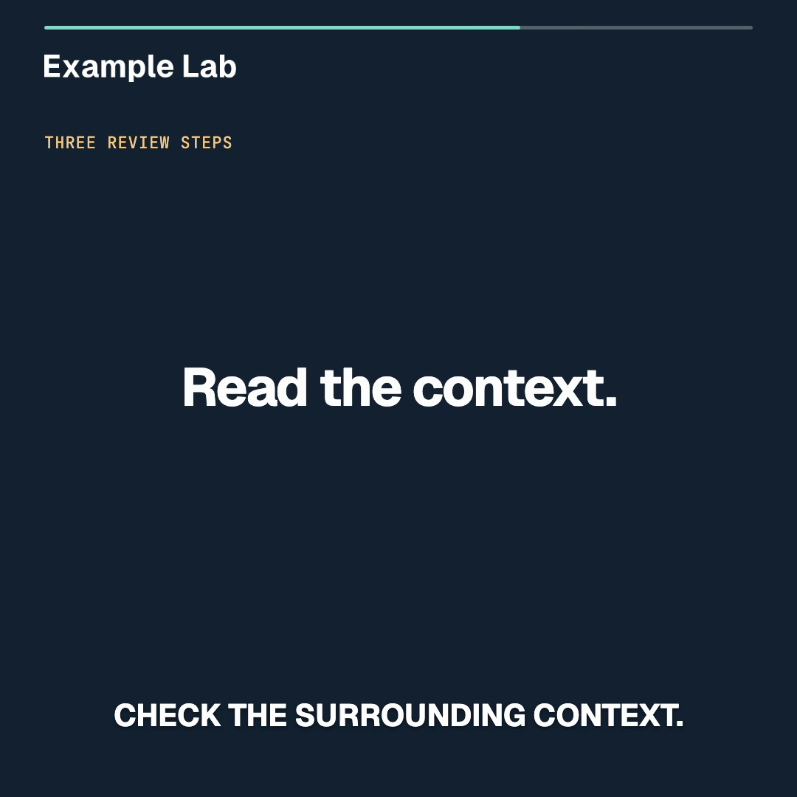</a> |

The first two titles share a moving headline carrier. The final scene switches
between three review steps on narration cues. Render `type-story` to see the
motion; still frames alone do not demonstrate transition continuity.
[Complete storyboard](../examples/v0.5.0/type-story/storyboard.json).

Read the [reproduction instructions](../examples/v0.5.0/README.md) and
[executed qualification](EXAMPLES-QA.md). Image hashes, dimensions and exact frame
numbers are recorded in the [manifest](images/manifest.json). Outputs remain
`review_required`; full narration and exported MP4s stay in your local workspace.

## Legacy v1/v2 Layouts

These are unmodified PNG captures from the local qualification runs, not generated
marketing mockups. The illustrative Signal Lab brand demonstrates the shared visual
system. Colors, logo and fonts come from branding; episode copy and timing remain
editable. Code, values and outcomes in examples are illustrative, not benchmarks.

Screenshots sample different points in a scene, so some timed captions may be absent
during natural cue gaps. They do not demonstrate audio quality or authorize publication.
Click an image to inspect it at 1080x1920.

## Agents and Tool Boundaries

| Prompt and tools | Policy as code | Approval gate |
| :---: | :---: | :---: |
| <a href="images/prompt-tools.png">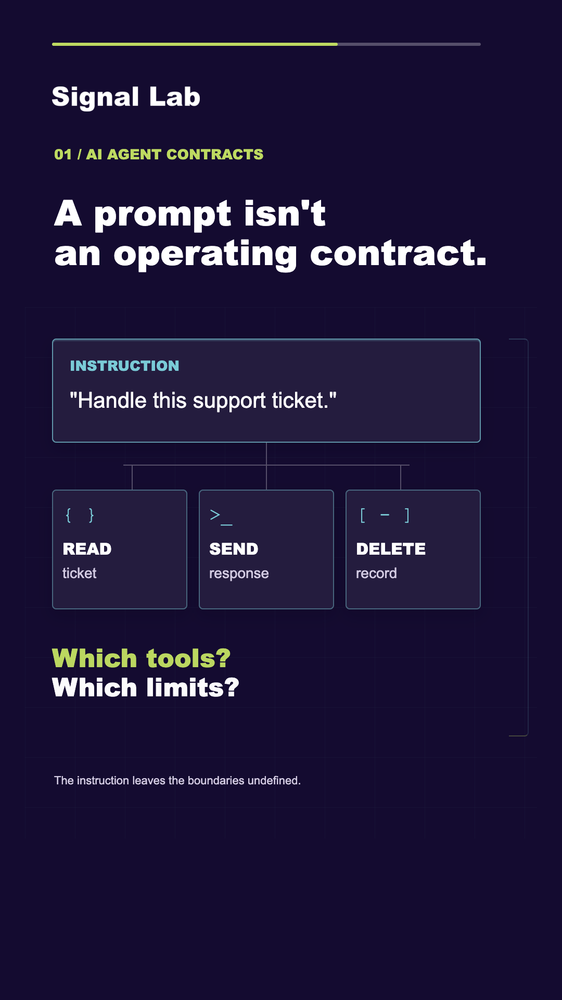</a> | <a href="images/code-policy.png">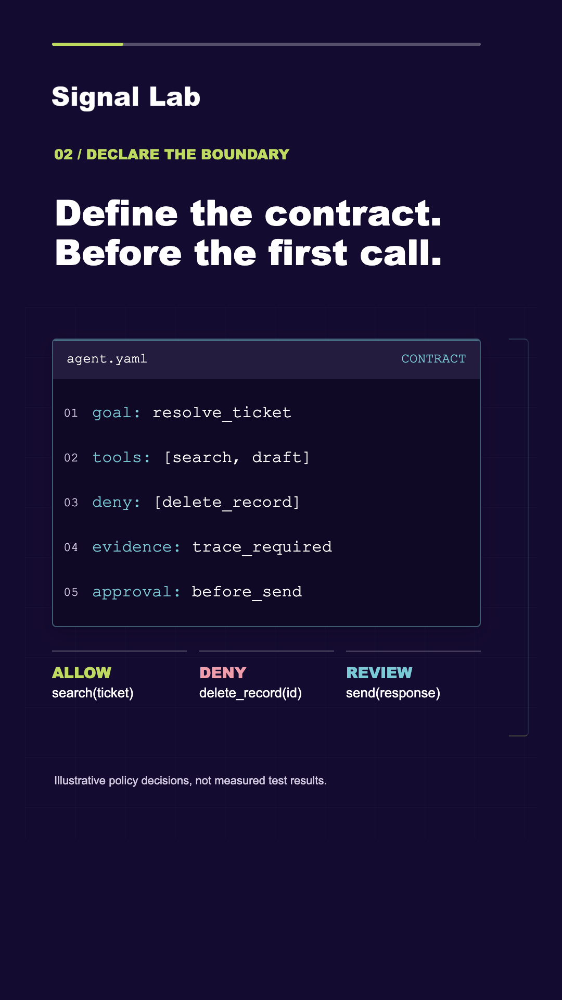</a> | <a href="images/approval-gate.png">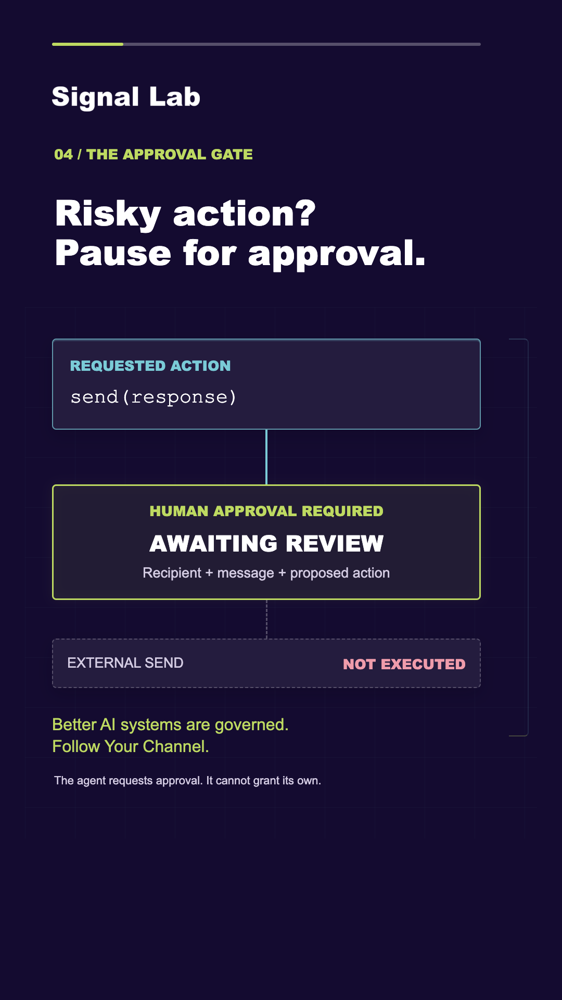</a> |
| [prompt-tools](../templates/v1/scenes/prompt-tools.json) | [code-policy](../templates/v1/scenes/code-policy.json) | [approval-gate](../templates/v1/scenes/approval-gate.json) |

Use these for a hook, a concrete code contract and a visible control point. Keep
tool names brief; don't shrink typography to accommodate a long API description.

## Retrieval and Evidence

| Retrieval checks | Evaluation code | Evidence comparison |
| :---: | :---: | :---: |
| <a href="images/retrieval-checks.png">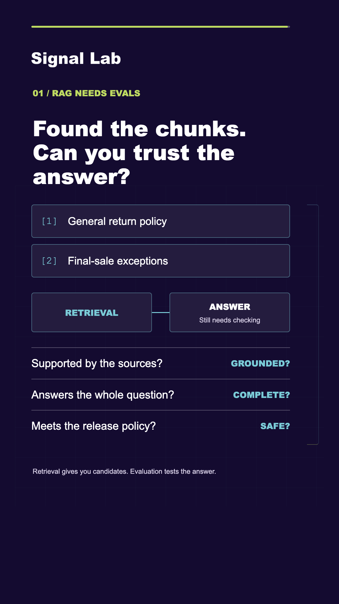</a> | <a href="images/code-evaluation.png">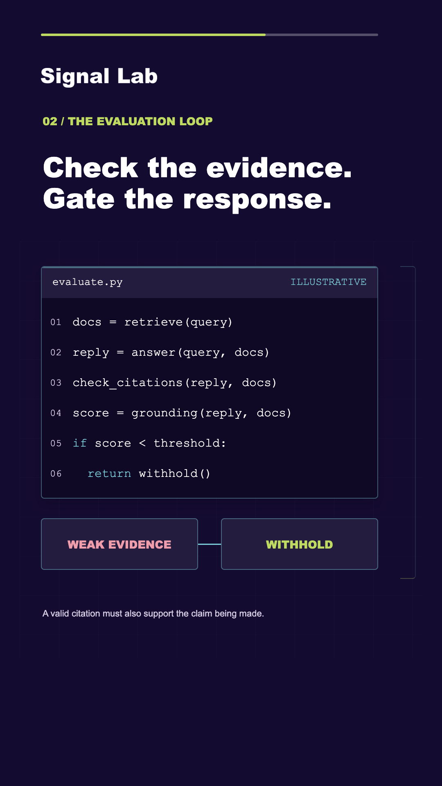</a> | <a href="images/evidence-comparison.png">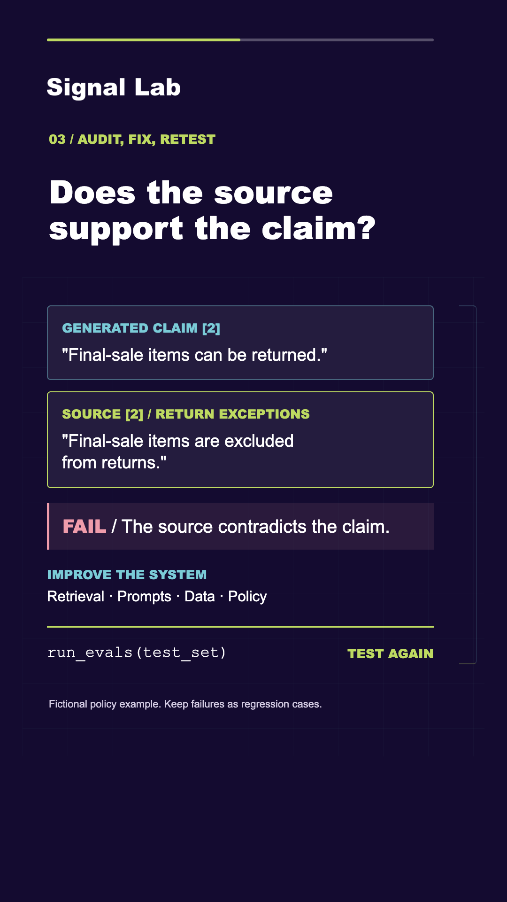</a> |
| [retrieval-checks](../templates/v1/scenes/retrieval-checks.json) | [code-evaluation](../templates/v1/scenes/code-evaluation.json) | [evidence-comparison](../templates/v1/scenes/evidence-comparison.json) |

Use these when the point is checking evidence rather than merely displaying a model
response. Replace sample figures with sourced values, or label them as illustrative.

## Controlled Automation

| Plan before action | Preview the change | Roll back safely |
| :---: | :---: | :---: |
| <a href="images/automation-plan.png">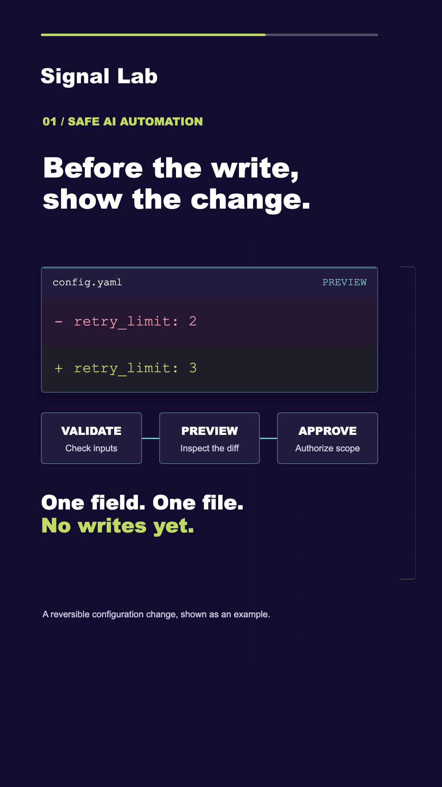</a> | <a href="images/automation-preview.png">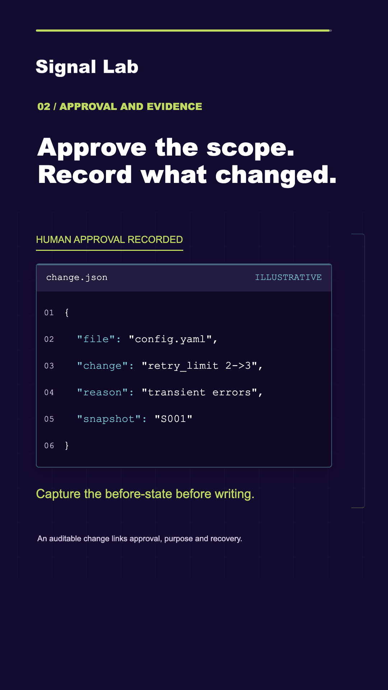</a> | <a href="images/automation-rollback.png">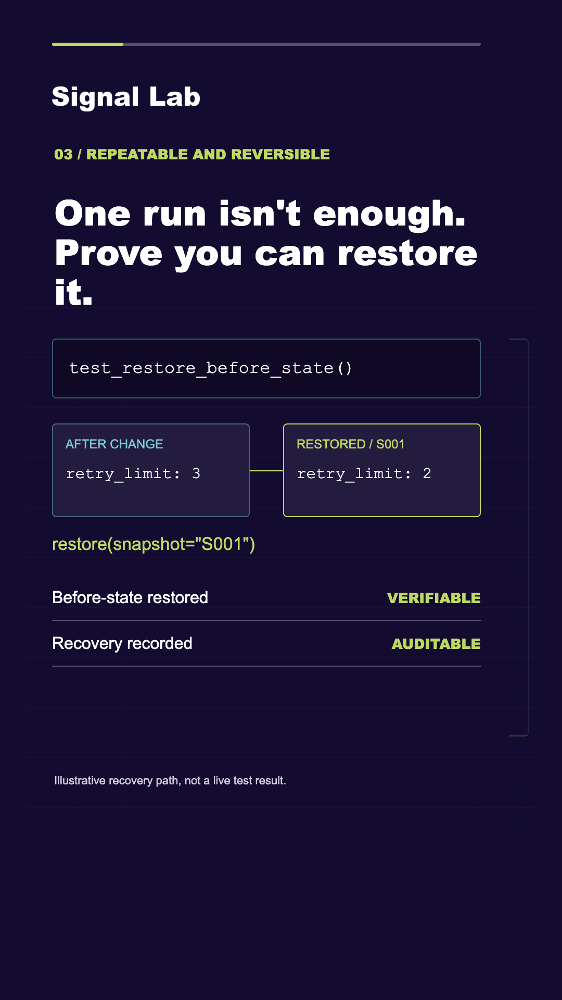</a> |
| [automation-plan](../templates/v1/scenes/automation-plan.json) | [automation-preview](../templates/v1/scenes/automation-preview.json) | [automation-rollback](../templates/v1/scenes/automation-rollback.json) |

Use these to explain the relationship between a proposed change, approval, evidence
and recovery. A diagram of a rollback is not implementation of a rollback mechanism.

## Pipelines and Conclusions

| Code pipeline | Concise closing | Automation closing |
| :---: | :---: | :---: |
| <a href="images/code-pipeline.png">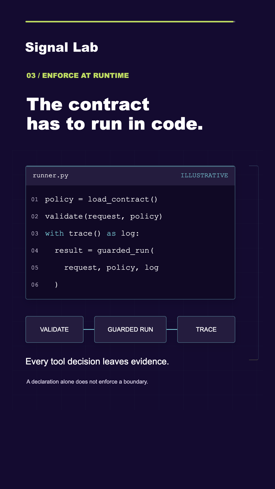</a> | <a href="images/closing.png">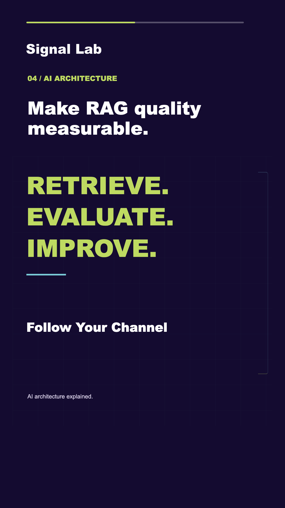</a> | <a href="images/automation-close.png">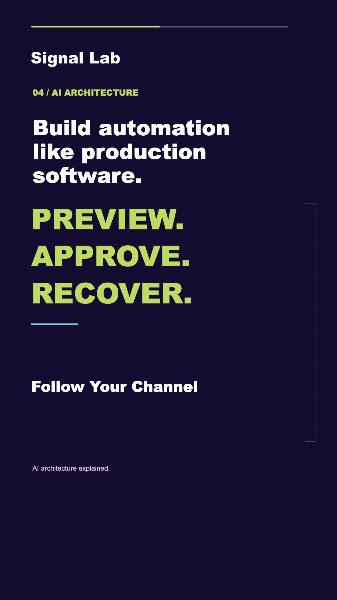</a> |
| [code-pipeline](../templates/v1/scenes/code-pipeline.json) | [closing](../templates/v1/scenes/closing.json) | [automation-close](../templates/v1/scenes/automation-close.json) |

Use one clear takeaway. Do not repeat the whole narration in the heading, diagram,
scene note and caption simultaneously.

## General-Purpose Scenes

Six classic layouts for any subject, added on 2026-09-16 and qualified with the
same browser checks as the original twelve. The example copy is illustrative.

| Quote card | Numbered steps | Headline stat |
| :---: | :---: | :---: |
| <a href="images/quote-card.png">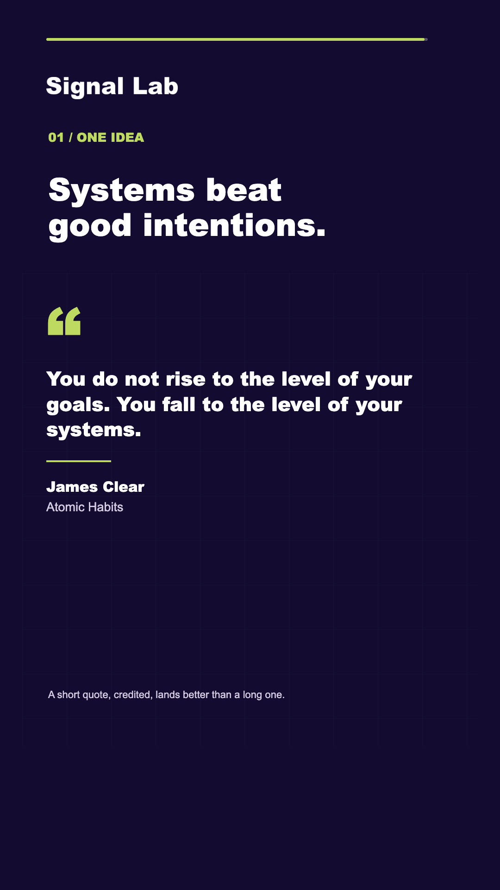</a> | <a href="images/numbered-steps.png">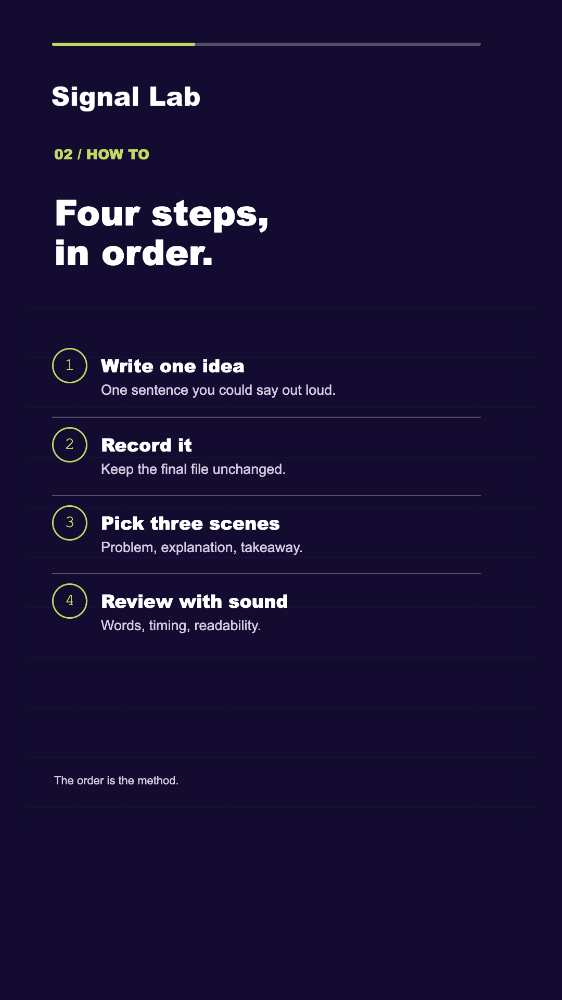</a> | <a href="images/headline-stat.png">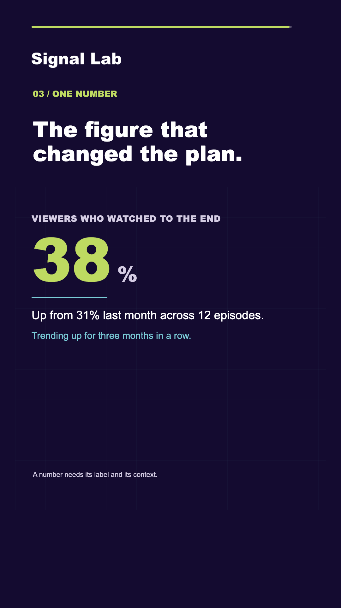</a> |
| [quote-card](../templates/v1/scenes/quote-card.json) | [numbered-steps](../templates/v1/scenes/numbered-steps.json) | [headline-stat](../templates/v1/scenes/headline-stat.json) |

| Checklist progress | Before and after | Pros and cons |
| :---: | :---: | :---: |
| <a href="images/checklist-progress.png">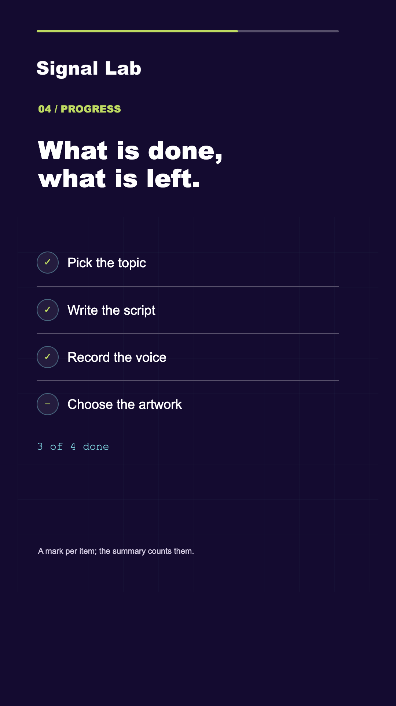</a> | <a href="images/before-after-panels.png">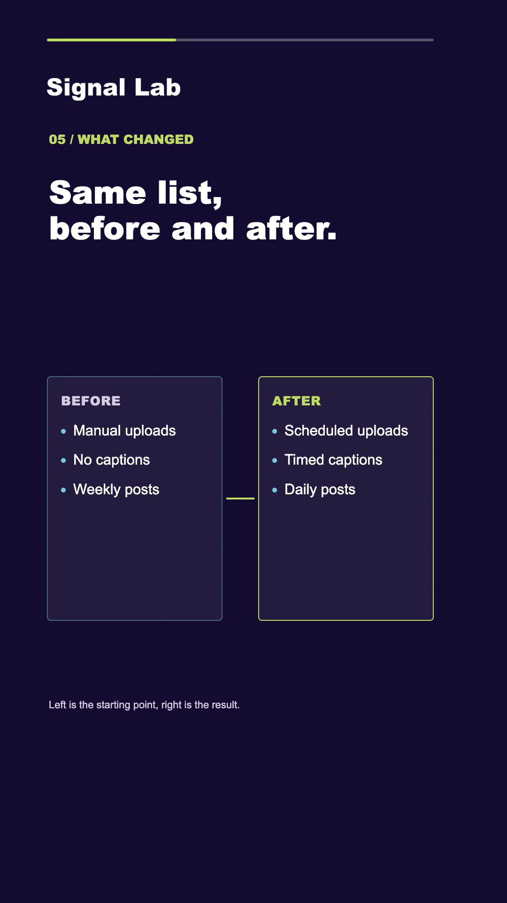</a> | <a href="images/pros-cons-columns.png">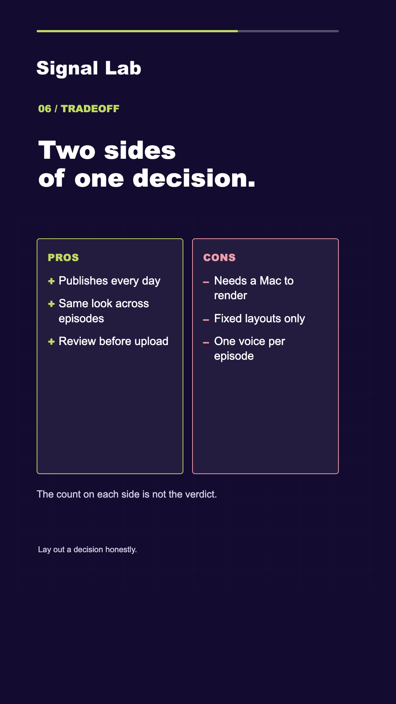</a> |
| [checklist-progress](../templates/v1/scenes/checklist-progress.json) | [before-after-panels](../templates/v1/scenes/before-after-panels.json) | [pros-cons-columns](../templates/v1/scenes/pros-cons-columns.json) |

Use these when the story is not about code: a credited sentence, a method in
order, one figure with context, progress through tasks, a change item by item,
or a decision with both sides. Slots are text; the checklist marks are whatever
character you supply.

## Reuse the Contract, Not Just the Picture

Each linked legacy layout JSON (eighteen in total) contains a fixed `tree`, `content_keys`, `motion_keys` and
an `example`. Use these records to create content; PNGs are documentation, not
editable production templates. Re-run visual QA after any change to text, timing,
fonts or branding. See [image provenance](images/README.md) for hashes and limitations.
